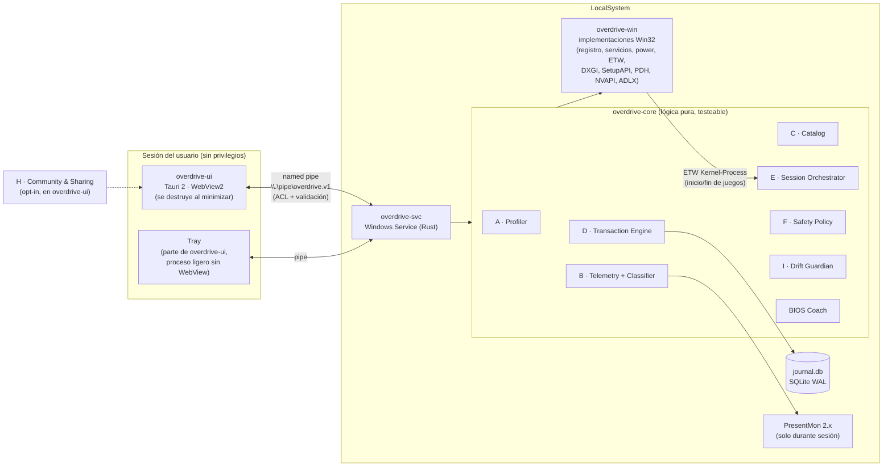
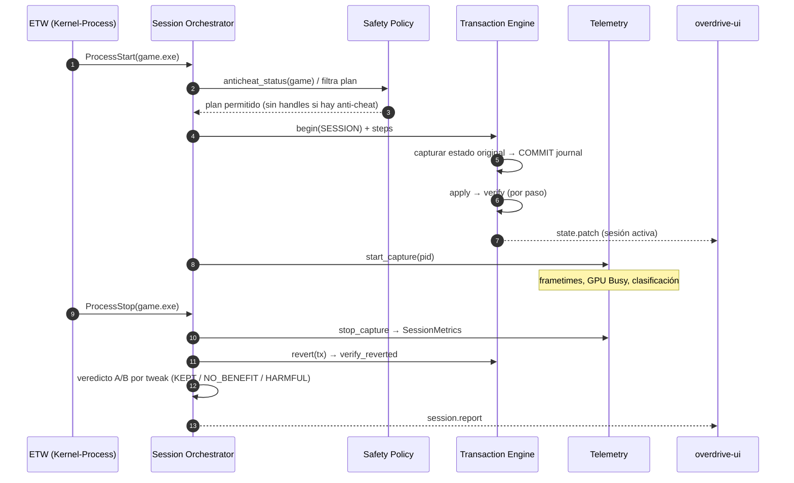

# Overdrive 1.0 — Arquitectura (Fase 1)

Entregables de la **Fase 1** de [`goals.md`](../../goals.md). Este documento es el índice y la visión general; el detalle está en:

| Documento | Contenido |
|---|---|
| [ADR-001-stack.md](ADR-001-stack.md) | Decisión de stack (Rust + Tauri 2 vs .NET AOT vs Electron) y estrategia de migración |
| [interfaces.md](interfaces.md) | Interfaces de todos los módulos (traits de Rust) y capa de abstracción del sistema |
| [ipc-protocol.md](ipc-protocol.md) | Protocolo IPC servicio ↔ UI: transporte, seguridad, mensajes, ciclo de vida de operaciones |
| [transaction-engine.md](transaction-engine.md) + [journal.sql](journal.sql) | Máquina de estados, journal write-ahead, recuperación ante crash |
| [migration.md](migration.md) | Qué pasa con cada módulo y cada tweak de la v0.2.1 |
| [risks.md](risks.md) | Registro de riesgos |

---

## 1. Vista general

**Reglas de frontera**

1. `overdrive-core` **no llama a Win32**. Todo acceso al sistema pasa por los traits de `SystemPort` (registro, servicios, power, ficheros, procesos, reloj…). En tests se sustituyen por fakes en memoria → todo el motor es testeable sin Windows real.
2. `overdrive-win` es la **única** crate con `unsafe` y llamadas al sistema.
3. La UI **no tiene privilegios y no ejecuta nada**: solo pide operaciones tipadas al servicio y pinta el estado que este le envía.
4. **Comunidad / compartir (H)** vive en la UI, no en el servicio: el proceso con privilegios nunca habla con Internet salvo el actualizador (manifiestos firmados).

## 2. Modelo de procesos

| Proceso | Cuenta | Arranque | Responsabilidad |
|---|---|---|---|
| `overdrive-svc` | LocalSystem | Automático (delayed start) | Motor completo, journal, detección de juegos por ETW, telemetría, recuperación |
| `overdrive-ui` | Usuario | Al iniciar sesión (tray) / bajo demanda (ventana) | Interfaz, tray, compartir, i18n |
| `PresentMon` | Hijo del servicio | Solo durante una sesión de juego | Captura de frametimes (ETW, sin inyección) |

- **Sin UAC después de instalar.** El instalador (una única elevación) registra el servicio. Esto elimina la clase entera de bugs de elevación de la v0.1.x.
- **Recuperación:** el servicio se configura con *recovery actions* del SCM (reiniciar a los 5 s / 30 s / 2 min). En cada arranque, **antes de aceptar conexiones**, ejecuta `TransactionEngine::recover()` y revierte cualquier transacción de sesión que quedó abierta (crash, kill, apagón). Ver [transaction-engine.md](transaction-engine.md).
- **Si se desinstala** el servicio, el desinstalador ejecuta antes `revert_all` (reset global verificado).

## 3. Ciclo de vida de una sesión

## 4. Presupuestos de consumo y cómo se miden

Objetivos de `goals.md §4.3`. **Método de medición** (script `tools/footprint.ps1`, se crea en la Fase 3 junto con el servicio y se ejecuta en CI en un runner Windows):

| Escenario | Métrica | Contador / herramienta | Duración | Criterio |
|---|---|---|---|---|
| Servicio en reposo | Memoria | `\Process(overdrive-svc)\Working Set - Private` | 10 min, muestra/1 s | máx < 15 MB |
| Servicio en reposo | CPU | `\Process(overdrive-svc)\% Processor Time` ÷ nº núcleos | 10 min | media < 0,1 % |
| Sesión con telemetría | Memoria | igual, sumando `PresentMon` | 10 min con juego sintético* | máx < 30 MB |
| Sesión con telemetría | CPU | igual, servicio + PresentMon | 10 min | media < 0,5 % de un núcleo |
| UI abierta | Memoria | suma del árbol `overdrive-ui` + `msedgewebview2` hijos | 2 min navegando | < 150 MB |
| UI minimizada | Procesos | ningún `msedgewebview2` hijo de `overdrive-ui` | — | 0 procesos |
| Wakeups | Despertares | WPR (`GeneralProfile`) + WPA, *CPU Usage (Precise)* | 5 min en reposo | < 1 wakeup/s |

\* Juego sintético: una app D3D11 mínima que presenta frames (`tools/fake-game`) para que el CI no dependa de juegos reales.

Diseño que hace posibles estas cifras:
- **Nada de sondeo.** Inicio/fin de procesos por ETW `Microsoft-Windows-Kernel-Process` (la v0.2.1 lanzaba PowerShell cada 6 s, ~50–80 MB y un pico de CPU por consulta).
- **Sin PowerShell** en el servicio.
- Drift Guardian disparado por eventos (Windows Update terminado, instalación de driver, reinicio), no por temporizador corto.
- El WebView2 se **destruye** al minimizar a la bandeja; el tray es una ventana Win32 sin WebView.

## 5. Trazabilidad: bugs del pasado → elemento de diseño que los impide

Criterio de terminado de la Fase 1: todo bug conocido está cubierto por el diseño.

| Bug / defecto | Causa raíz | Cómo lo impide el diseño |
|---|---|---|
| **v0.2.1** — el Modo Juego congelaba las apps | `NtSuspendProcess` sin política; procesos acoplados al juego (overlays, voz, launcher) congelados | `SafetyPolicy::background_action()` decide por proceso con lista de *nunca tocar* (audio, voz en llamada, launcher/DRM, anti-cheat, ventana en primer plano); por defecto **EcoQoS / prioridad baja**, suspender solo categorías seguras y visibles; reanudar garantizado en todos los caminos de salida (fin de juego, parada del servicio, `recover()`, botón "Reanudar todo", y al traer la app al primer plano). Ver [interfaces.md §F](interfaces.md#f--safety-policy) |
| **v0.1.2** — overlay "Aplicando…" siempre visible | La UI asumía estado en vez de leerlo | La UI es una **función pura del `EngineSnapshot`**. Toda operación tiene `opId` y termina siempre en `done | failed | timed_out | cancelled`. Al reconectar, la UI pide un snapshot completo. Ver [ipc-protocol.md §4](ipc-protocol.md#4-ciclo-de-vida-de-una-operación) |
| **v0.1.1** — el punto de restauración colgaba el flujo | Llamada bloqueante sin límite; Windows limita a 1 punto cada 24 h y puede tardar minutos | Toda operación tiene `deadline`. El punto de restauración es un paso **no bloqueante** con timeout y camino de fallo definido: el journal ya garantiza la reversión, así que se informa y se continúa |
| **v0.1.x** — la elevación de admin fallaba empaquetado | Elevar desde la propia app en runtime | El servicio se instala una vez con el instalador; **la UI nunca se eleva** |
| **v0.2.1 (detectado en esta revisión)** — revertir no devuelve el estado original | Los `revert` escriben valores fijos (p. ej. `power-high` vuelve siempre a "Equilibrado", HAGS a `1`, `PowerThrottlingOff` a `0` en vez de borrar la clave) | Cada paso **captura el estado original** (incluido "la clave no existía") y lo guarda en el journal antes de aplicar; `revert` restaura exactamente eso y `verify_reverted` lo comprueba |
| **v0.2.1 (detectado)** — si Overdrive se cierra con un juego abierto, los tweaks del perfil se quedan aplicados | `activeProfiles` solo en memoria | Las transacciones de sesión viven en el journal; `recover()` las revierte al siguiente arranque del servicio |
| **v0.2.1 (detectado)** — fallos silenciosos | `catch (_) {}` en aplicar/revertir perfiles | Cada paso registra su resultado en el journal; los fallos llegan a la UI como `op.failed` con un mensaje accionable; nunca se descarta un error |

## 6. Checklist de la Fase 1

- [x] Diagrama de arquitectura (servicio / UI / recuperación / IPC) — §1–§3
- [x] Interfaz definida para cada módulo de `goals.md §4.4` (A–I) — [interfaces.md](interfaces.md)
- [x] Esquema de mensajes IPC — [ipc-protocol.md](ipc-protocol.md)
- [x] Esquema del journal — [journal.sql](journal.sql)
- [x] Registro de decisión de stack + plan de migración — [ADR-001](ADR-001-stack.md), [migration.md](migration.md)
- [x] Registro de riesgos — [risks.md](risks.md)
- [x] Cada bug pasado mapeado a su elemento de diseño — §5
- [x] Método de medición para los presupuestos de consumo — §4
