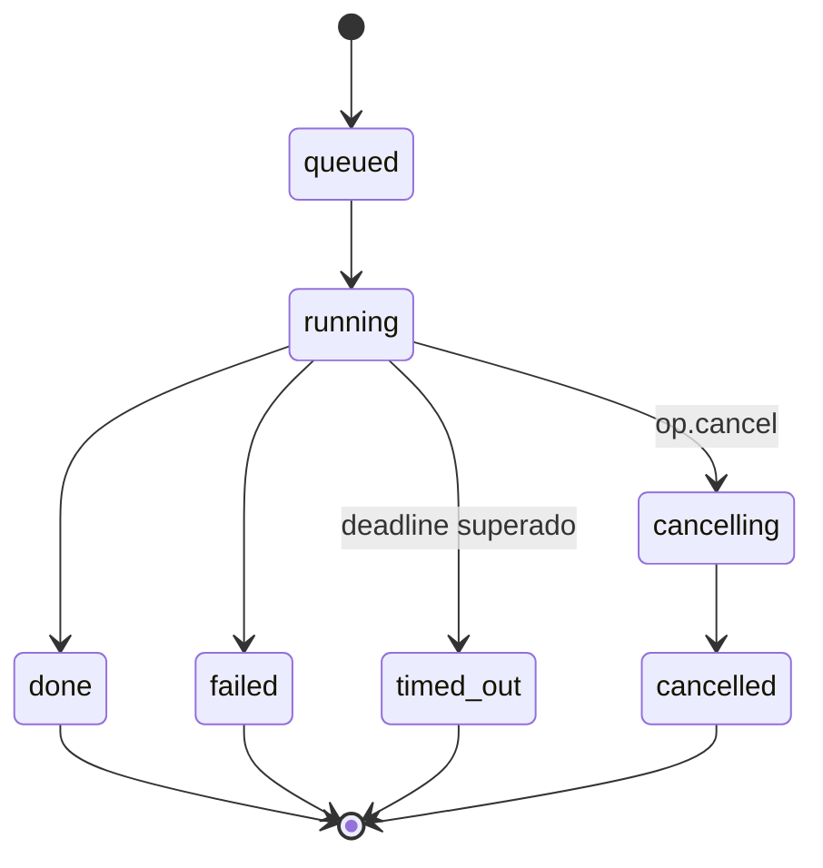

# Protocolo IPC servicio ↔ UI (`overdrive.v1`)

## 1. Transporte

- **Named pipe** `\\.\pipe\overdrive.v1`, en modo mensaje, abierto por `overdrive-svc`.
- **Tramas:** prefijo de longitud `u32` little-endian seguido de JSON UTF-8. Máximo 1 MiB por trama; las tramas mayores se rechazan y se cierra la conexión.
- **Versionado:** el nombre del pipe incluye la versión mayor. Cualquier cambio que rompa compatibilidad exige un pipe nuevo (`.v2`), y el servicio puede atender ambos durante una transición.
- **Tipos compartidos:** se definen en `crates/overdrive-proto` (serde) y se generan como TypeScript para la UI. El motor simulado de la Fase 2 usa exactamente esos mismos tipos.

## 2. Seguridad (el servicio corre como LocalSystem)

1. **DACL del pipe:** acceso de lectura y escritura solo para `SYSTEM` y para el SID del usuario de la sesión interactiva activa. Se deniega el acceso remoto con `PIPE_REJECT_REMOTE_CLIENTS` y no se usan sesiones anónimas.
2. **Verificación del cliente:** con `GetNamedPipeClientProcessId` se obtiene el proceso que se conecta. El servicio acepta la conexión solo si:
   - la imagen está en el directorio de instalación;
   - tiene firma Authenticode válida del editor de Overdrive (en builds firmadas);
   - pertenece a la sesión interactiva.
3. **Sin ejecución arbitraria.** No existe ningún mensaje que acepte comandos, scripts, rutas libres de registro o de ficheros. El servicio solo ejecuta **tweaks del catálogo por id**. Las rutas de juegos se resuelven en el servicio a partir de la biblioteca detectada.
4. **Validación estricta:** el esquema se valida con `serde(deny_unknown_fields)` y límites en todas las listas y cadenas.
5. **Rate limiting** por conexión, para evitar que un cliente sature el servicio.

## 3. Forma de los mensajes

```jsonc
// UI → servicio: petición
{ "kind": "req", "id": 42, "method": "session.optimize", "params": { "gameId": "steam:730" } }

// servicio → UI: respuesta inmediata (aceptada; el trabajo largo es una operación)
{ "kind": "res", "id": 42, "ok": true, "result": { "opId": "op_7f3a" } }
{ "kind": "res", "id": 43, "ok": false, "error": { "code": "ANTICHEAT_BLOCKED", "messageKey": "err.anticheat_blocked", "details": {} } }

// servicio → UI: eventos (push)
{ "kind": "evt", "seq": 1031, "type": "state.patch", "data": { /* JSON Merge Patch sobre EngineSnapshot */ } }
```

- `seq` es monótono por arranque del servicio, que además envía un `bootId`. Si la UI detecta un salto de `seq` o un `bootId` distinto, **pide `state.snapshot` completo**. Así la UI nunca queda con un estado desincronizado.

### Métodos (lista cerrada)

| Método | Params | Resultado | Notas |
|---|---|---|---|
| `hello` | `{ uiVersion, locale }` | `{ bootId, svcVersion, protocol: 1 }` | Primer mensaje obligatorio |
| `state.snapshot` | — | `EngineSnapshot` | Al conectar y al detectar huecos |
| `hardware.rescan` | — | `{ opId }` | |
| `plan.preview` | `{ gameId }` | `PlanPreview` | Capa 2: tweaks, alcance, riesgo, evidencia, por qué |
| `plan.setToggle` | `{ gameId, tweakId, enabled }` | `PlanPreview` | |
| `session.optimize` | `{ gameId }` | `{ opId }` | Aplica el plan de sesión (o lo arma para el próximo arranque del juego) |
| `session.benchmark` | `{ gameId }` | `{ opId }` | Benchmark guiado A/B |
| `persistent.accept` | `{ tweakId }` | `{ opId }` | Respuesta a "¿mantenerlo siempre?" |
| `persistent.revert` | `{ tweakId }` | `{ opId }` | |
| `tx.revertAll` | — | `{ opId }` | Reset global verificado |
| `background.resumeAll` | — | `{ opId }` | Botón del tray "Reanudar todo" |
| `background.setWhitelist` | `{ images: string[] }` | `ok` | |
| `bios.startFlow` | `{ issueId }` | `CoachFlow` | |
| `bios.rebootToFirmware` | `{ confirm: true }` | `{ opId }` | Requiere confirmación explícita en la UI |
| `report.session` | `{ txId }` | `SessionReport` | |
| `report.health` | `{ month }` | `HealthSummary` | |
| `foreign.restoreDefaults` | `{ foreignTweakId }` | `{ opId }` | Deshacer tweaks dañinos de otras herramientas |
| `settings.get` / `settings.set` | `{ mode?, telemetryOptIn?, … }` | `Settings` | |
| `op.cancel` | `{ opId }` | `ok` | Solo si la op es cancelable; cancelar = revertir lo hecho |

### Eventos

| Tipo | Contenido |
|---|---|
| `state.patch` | Merge patch del snapshot (la única fuente de verdad de la UI) |
| `op.progress` | `{ opId, step, total, labelKey, elapsedMs }` |
| `op.finished` | `{ opId, outcome: "done" \| "failed" \| "timed_out" \| "cancelled", result?, error? }` |
| `prompt.ask` | Preguntas en lenguaje sencillo (p. ej. "¿Mantener siempre?") con `promptId` y opciones |
| `session.report` | Al cerrar un juego |

## 4. Ciclo de vida de una operación

Diseño contra el bug de la v0.1.2: un overlay sin estado final no puede existir.



Reglas:
1. Toda operación larga aparece en `EngineSnapshot.operations` con `deadline`, `cancellable` y `elapsedMs`. **La UI solo muestra overlays o barras de progreso de operaciones presentes en el snapshot.** Si la operación desaparece del snapshot, el overlay desaparece.
2. Toda operación termina **siempre** con `op.finished`. Aunque el servicio muera, la UI detecta la desconexión, marca la operación como `failed (service_disconnected)` y al reconectar pide el snapshot, que ya incluye el resultado de `recover()`.
3. `timed_out` no deja el sistema a medias: el motor revierte los pasos de esa transacción que ya se aplicaron.
4. Cada `failed` lleva un `messageKey` accionable ("Windows no permitió cambiar X. No se ha modificado nada."). No se usan errores genéricos.

## 5. Entre la UI web y el núcleo de Tauri

- El WebView solo habla con `src-tauri` mediante comandos de Tauri con lista blanca y la *capability* mínima. No se habilitan los plugins `shell` ni `fs`.
- `src-tauri` es un **relé**: mantiene una conexión al pipe, reenvía peticiones y emite eventos al WebView. Cuando se destruye la ventana, la conexión sigue viva para el tray.
