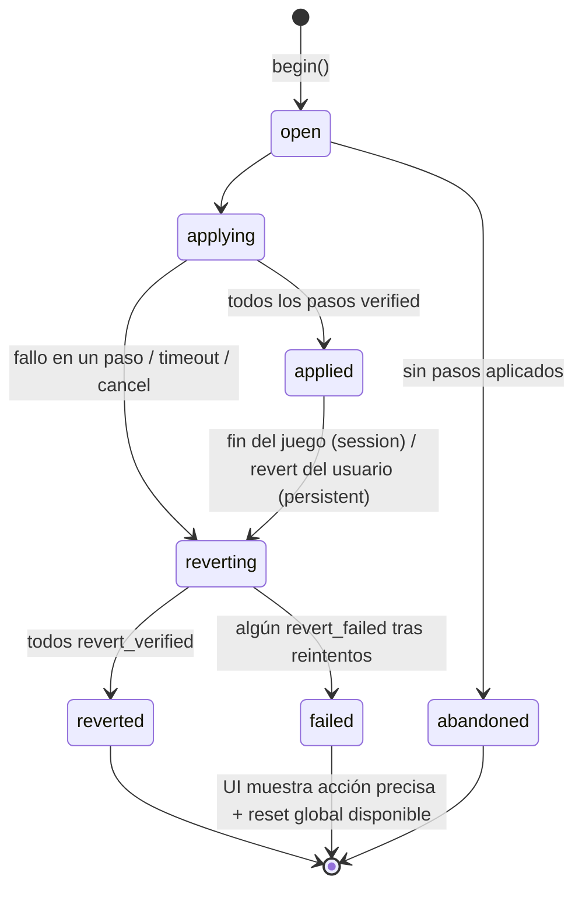
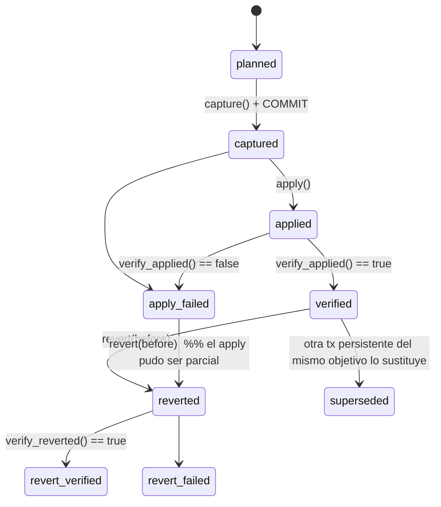

# Transaction Engine — qué significa "atómico" en Overdrive

Windows no ofrece transacciones reales sobre registro, servicios, power y ficheros a la vez (TxF/TxR están obsoletos). Overdrive consigue el efecto equivalente con un **journal write-ahead** y **pasos idempotentes con verificación**. Esquema: [journal.sql](journal.sql).

## 1. Garantías

| Garantía | Mecanismo |
|---|---|
| Nunca se cambia algo cuyo valor original no esté guardado | El paso pasa a `captured` con `before_json` y se hace **COMMIT** (`synchronous=FULL`) *antes* de llamar a `apply` |
| Reversión exacta, no valores fijos | `revert(before)` restaura lo capturado, incluido "la clave no existía" (se borra) o "el servicio estaba parado" |
| Sobrevive a crash, kill o apagón | `recover()` al arrancar el servicio, antes de aceptar conexiones IPC |
| Reintentos seguros | Todas las primitivas son idempotentes: aplicar dos veces o revertir dos veces da el mismo resultado |
| Nada se da por hecho | `verify_applied` / `verify_reverted` leen el estado real tras cada operación |
| Sin fallos silenciosos | Todo fallo queda en el journal (`error_code`) y llega a la UI como `op.finished: failed` |

## 2. Estados

### Transacción

### Paso

## 3. Recuperación (`recover()`)

Se ejecuta en cada arranque del servicio:

1. Busca transacciones `kind='session'` en `open | applying | applied | reverting`.
2. Para cada una, revierte en **orden inverso de `seq`** todos los pasos en `captured | applied | verified | apply_failed | revert_failed`. Un paso en `captured` también se revierte, porque el corte pudo llegar a mitad de `apply`, y como `revert(before)` es idempotente es seguro hacerlo.
3. Las acciones sobre procesos (EcoQoS, prioridad, suspensión) son pasos `process_*` de la transacción de sesión, así que el punto 2 las revierte: los procesos suspendidos se reanudan y las prioridades se restauran, identificando cada proceso por `(pid, start_time)`. Si el proceso ya no existe, no hay nada que restaurar.
4. Las transacciones **`persistent` no se revierten**, porque son cambios que el usuario aceptó mantener. Sí se verifican: una transacción persistente que quedó a medias se revierte entera (todo o nada); si un revert falló antes, se reintenta.
5. Registra `boots.recovered = 1` y genera un aviso en lenguaje sencillo para la UI: "Overdrive se cerró inesperadamente durante tu partida. Hemos dejado tu PC como estaba."

## 4. Conflictos y superposición

- **Una sola transacción de sesión activa por juego.** Si hay dos juegos abiertos a la vez, los pasos que comparten objetivo (por ejemplo, el power scheme) se **referencian** en lugar de duplicarse, y se revierten cuando cierra el último.
- **Sesión sobre persistente:** si una sesión toca un objetivo que ya tiene un cambio persistente, su `before` es el valor persistente, no el original de Windows. Así, al cerrar el juego se vuelve al estado aceptado por el usuario.
- **Valor modificado por terceros durante la sesión:** antes de revertir se compara el valor actual con `after_json`. Si alguien (el usuario, Windows u otra app) lo cambió, **no se sobrescribe**. El paso se marca y se informa en el reporte.

## 5. Reset global (`revert_all`)

1. Revierte todas las transacciones de sesión abiertas.
2. Revierte todos los pasos persistentes vivos (`ix_steps_alive`), en orden inverso de creación.
3. Restaura los ficheros desde `file_backups` y comprueba que el hash coincide.
4. Hace un diff de cada objetivo del journal contra su `before` original. El reporte final lista cualquier diferencia; el objetivo es que salga vacío.
5. Lo ejecuta también el desinstalador.

## 6. Punto de restauración

- Se crea antes de la **primera** transacción `persistent` (no antes de las de sesión, que ya están cubiertas por el journal).
- Es un paso **no bloqueante**, con un timeout de 90 s. Si Windows lo rechaza (límite de 1 cada 24 h, protección del sistema desactivada, etc.), se informa y se continúa: el journal ya garantiza la reversión. Es la lección de la v0.1.1.

## 7. Prueba de aceptación (Fase 5)

Prueba en VM, para Windows 10 y Windows 11: para cada paso N de una sesión con todos los tipos de primitiva, se mata el servicio justo después de N (y se repite con un apagón simulado de la VM). Tras reiniciar, el registro, los servicios, el power scheme, los ficheros y las prioridades deben quedar **idénticos byte a byte** al snapshot previo a la sesión.
